# OpenMU Eclipse

*[Wersja polska](README.pl.md)*

A dark high-fantasy WordPress block theme for [OpenMU](https://github.com/MUnique/OpenMU) (MU Online server
emulator) websites. Black sun, golden corona, ruined castle: an animated eclipse scene, a three-class showcase,
a glassy sticky header and ready-made pages.

It is made for the **[OpenMU WP Connect](https://github.com/nolt/openmu-wp-connect)** plugin, which brings the live
server data (status, rankings, armory, events, account). Without the plugin the theme works as a site with news,
and the server pages say that the plugin is needed.

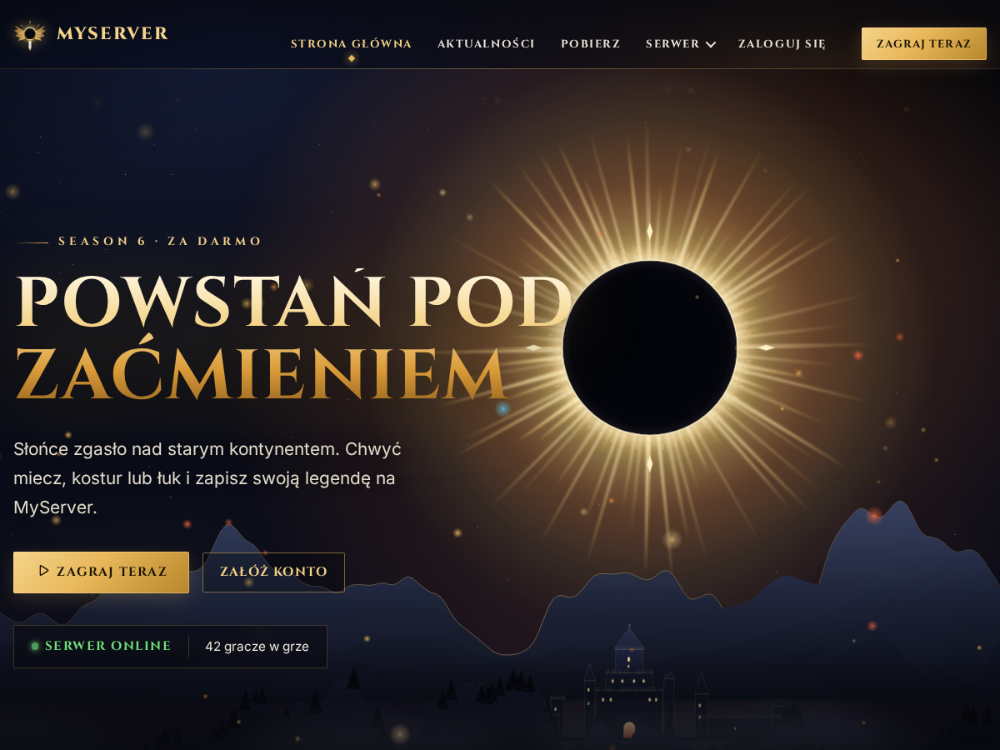

## Features

- **Home page**: full-screen animated hero (parallax layers, canvas embers, pulsing corona), live server status,
  class showcase (Dark Knight, Dark Wizard, Fairy Elf), latest news, how to start, event schedule, top 5 ranking,
  download/Discord call to action, rich footer.
- **Calm animated background** on every other page. `prefers-reduced-motion` gives a static scene; the animation
  pauses in a hidden tab.
- **Header**: sticky, glass, compact on scroll; menu built from pages by address (Home, News, Download, *Server*
  submenu: Ranking, Mini games, Armory, Events, Commands; Account); works on touch; full-screen menu on phones;
  *Play now* button.
- **Templates**: front page, news, archive, single post, page, wide page, search, 404 and one template per server page
  (ranking, mini games, armory, events, commands, download, account).
- **Plugin styling** for [OpenMU WP Connect](https://github.com/nolt/openmu-wp-connect): status, ranking, mini game
  ranking, events, armory, account forms, tooltips, notices.
- Bundled fonts (Cinzel, Inter; SIL OFL) as woff2: no external requests at runtime. Small deferred vanilla JS.
- Translations: English, Polish.

## Requirements

- WordPress 6.6 or later (tested with 7.1), PHP 8.1 or later (tested with 8.4).
- Optional: the [OpenMU WP Connect](https://github.com/nolt/openmu-wp-connect) plugin, for live data from the game server.

## Installation

1. Download `openmu-eclipse-<version>.zip` from [Releases](../../releases) and upload it under
   **Appearance > Themes > Add New Theme > Upload Theme**, or copy this repository to
   `wp-content/themes/openmu-eclipse`. Activate **OpenMU Eclipse**.
2. Install the [OpenMU WP Connect](https://github.com/nolt/openmu-wp-connect) plugin and connect it to your server.
3. Set the real links: the buttons on the **Download** page and the Discord links (they point to `#` until you do).

## What activating does

Activating the theme creates the pages it needs by address (Home, News, Download, Ranking, Mini games, Armory,
Events, Commands, Account), makes Home the front page and News the posts page, and restores your previous
reading settings when you switch to another theme. Pages with other addresses are left alone.

## Class pictures and item data in the armory (optional)

The theme ships no files of the game client. The OpenMU WP Connect plugin looks for them in
`wp-content/uploads/openmu-wp-connect-client/` and uses each part it finds there; whatever is
missing falls back to the theme's own look:

| Folder | Gives | Without it |
|---|---|---|
| `classes/` | a full-body picture of the character's class in the armory | the class emblem |
| `data/` (`items.json`, `item-sets.json`, `skills.json`) | full item tooltips: base stats, requirements, descriptions | the tooltip with what the API sends |
| `character-view/` | armory windows from the client's textures | windows in the colours of the theme |

Copy the folders to the server once (SFTP, ssh, `docker cp`); WordPress's media upload can't
create them. The same folder works for every theme.

## Pages

With the plugin in demo mode, desktop 1440 px wide. Click a picture for the full size.

| | | |
| --- | --- | --- |
| [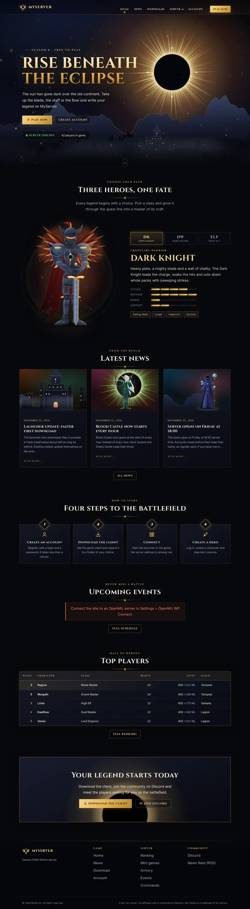](docs/assets/pages/home.webp) Front page | [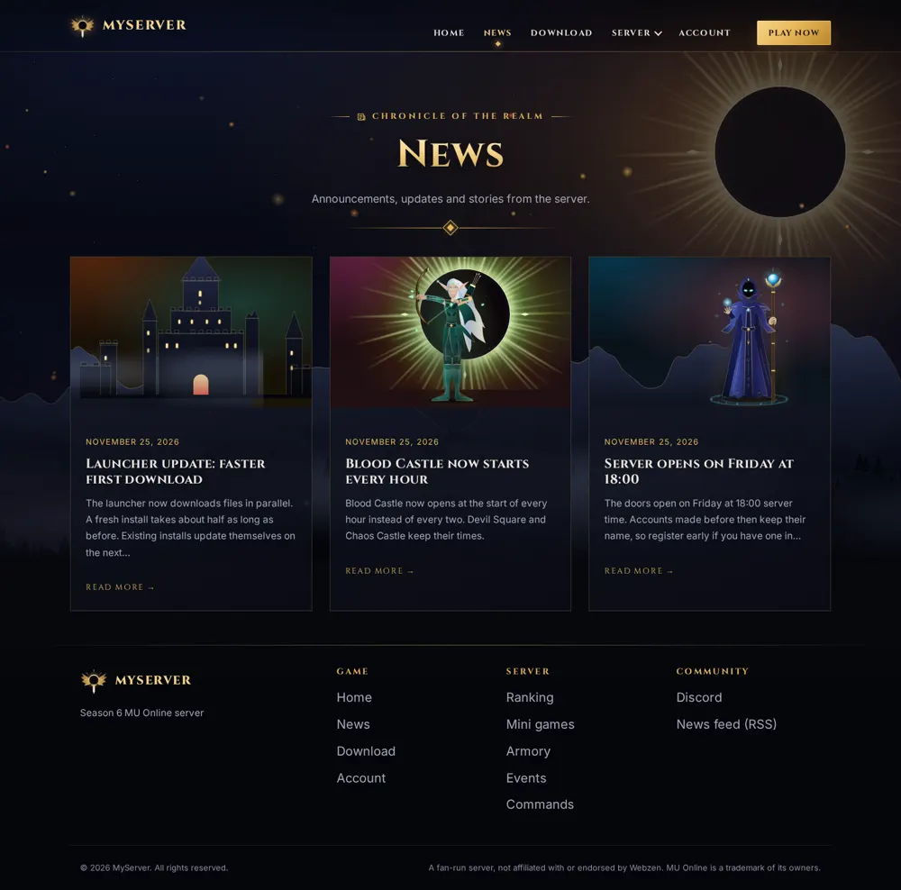](docs/assets/pages/news.webp) News | [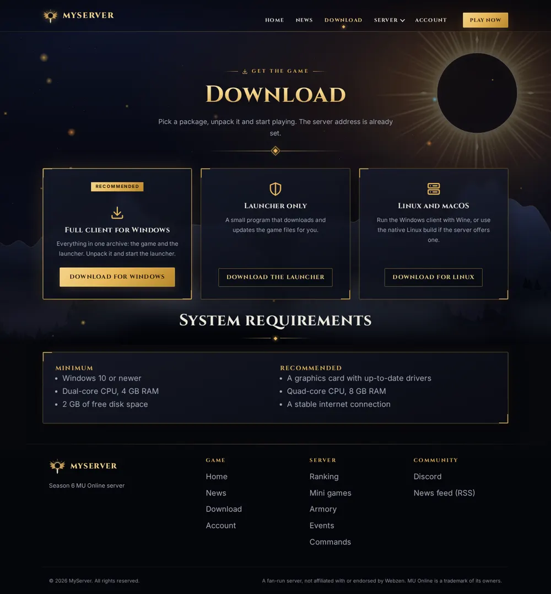](docs/assets/pages/download.webp) Download |
| [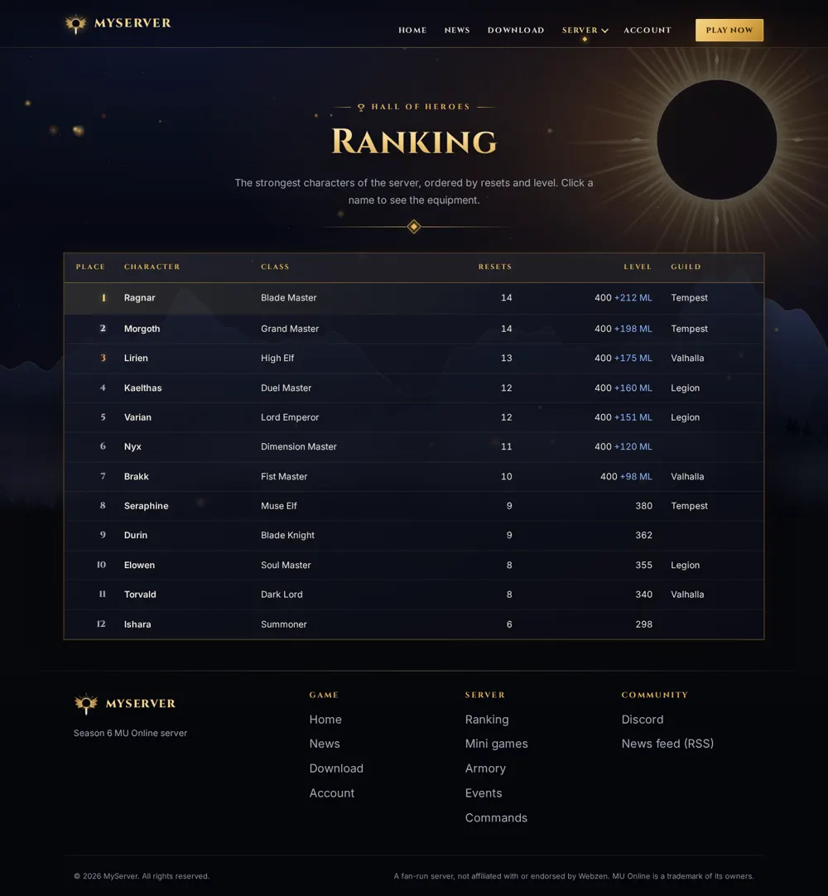](docs/assets/pages/ranking.webp) Ranking | [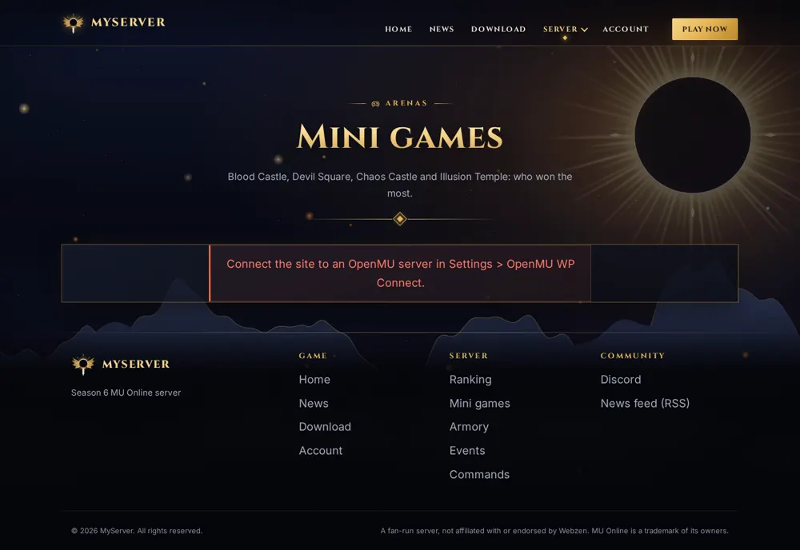](docs/assets/pages/mini-games.webp) Mini games | [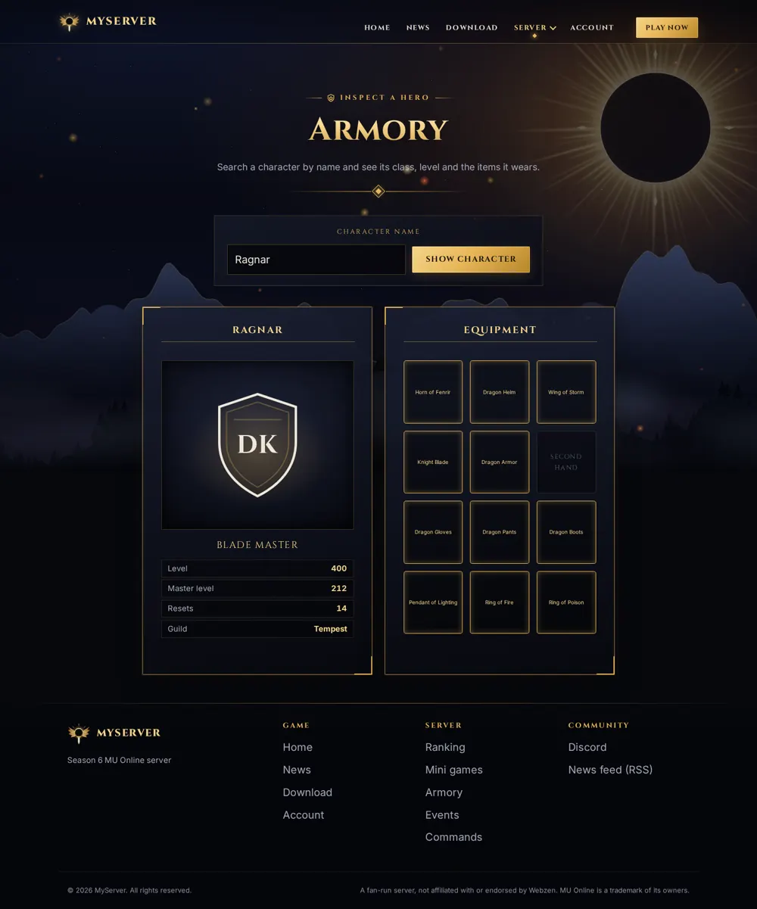](docs/assets/pages/armory.webp) Armory |
| [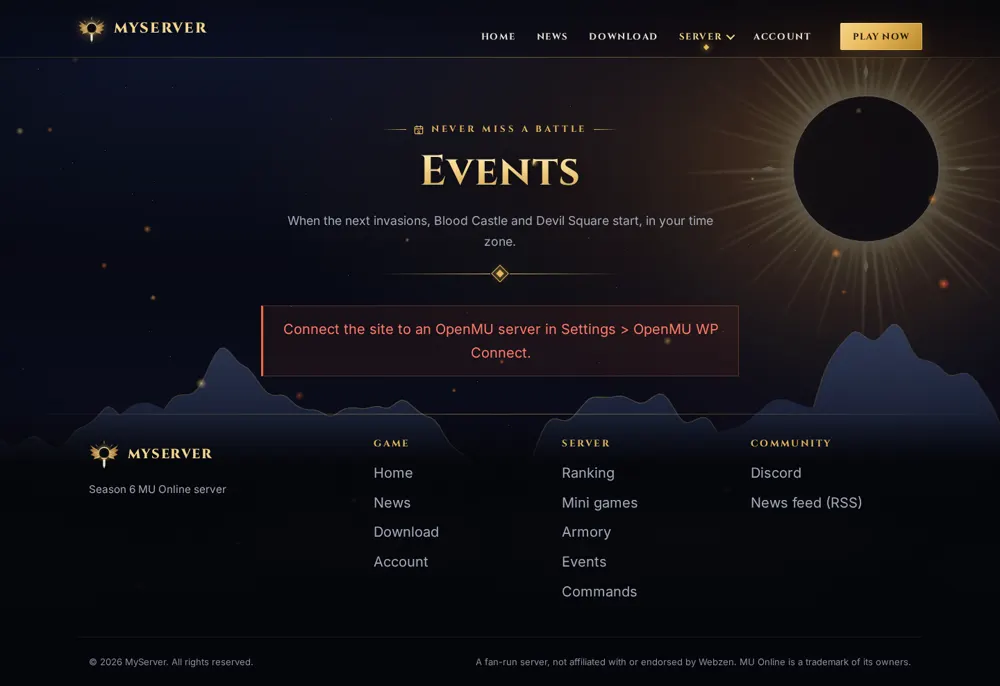](docs/assets/pages/events.webp) Events | [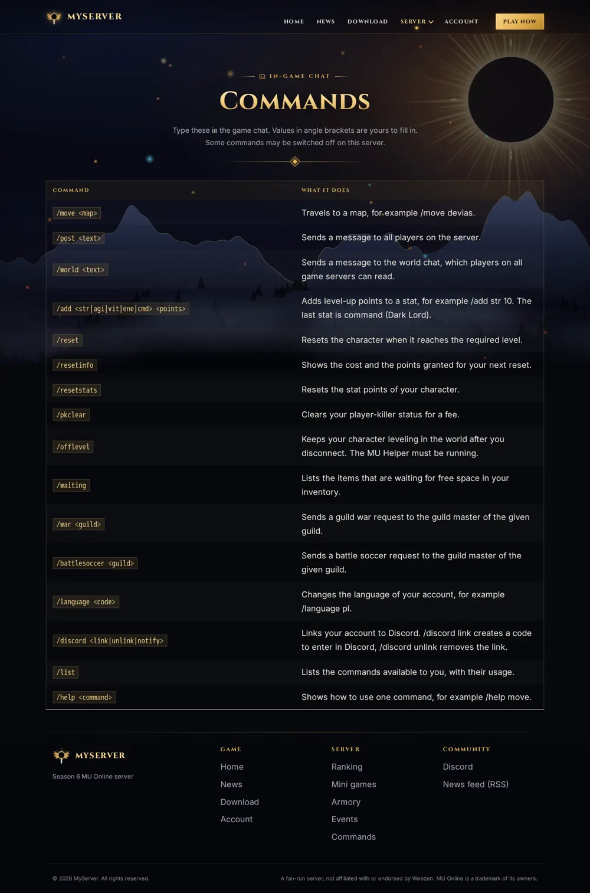](docs/assets/pages/commands.webp) Commands | [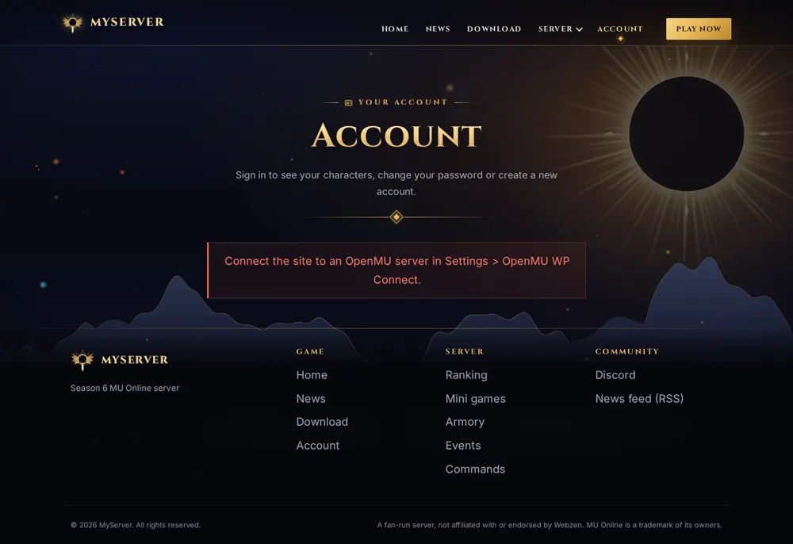](docs/assets/pages/account.webp) Account |

| | | |
| --- | --- | --- |
| [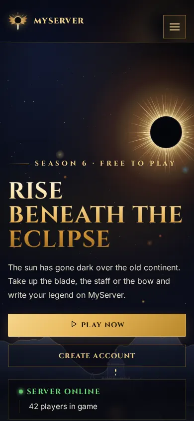](docs/assets/pages/phone-home.webp) Front page | [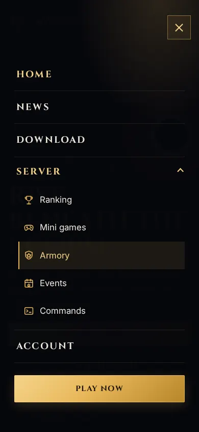](docs/assets/pages/phone-menu.webp) Menu | [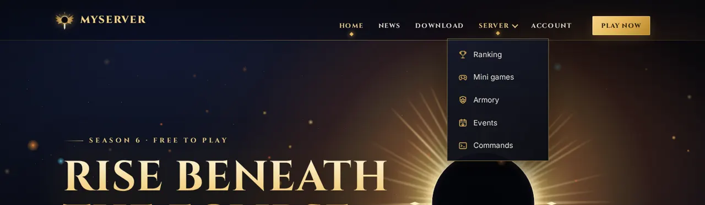](docs/assets/pages/menu-desktop.webp) Server menu (desktop) |

## Artwork and credits

Every graphic is original hand-written SVG made for this theme (see [`assets/art/README.md`](assets/art/README.md)).
Fonts: Cinzel and Inter, SIL Open Font License 1.1 (`assets/fonts/`).

MU Online is a trademark of Webzen. This project is a fan work, not affiliated with or endorsed by Webzen.

## License

GPL-2.0-or-later. Copyright (c) 2026 Nolt.
