# OpenMU Eclipse

*[English version](README.md)*

Mroczny blokowy motyw WordPress w klimacie high fantasy dla stron serwerów [OpenMU](https://github.com/MUnique/OpenMU)
(emulator serwera MU Online). Czarne słońce, złota korona, ruiny zamku: animowana scena zaćmienia, prezentacja
trzech klas, szklany przyklejony nagłówek i gotowe strony.

Motyw powstał do wtyczki **[OpenMU WP Connect](https://github.com/nolt/openmu-wp-connect)**, która dostarcza dane
serwera na żywo (status, rankingi, zbrojownia, wydarzenia, konto). Bez wtyczki motyw działa jako strona
z aktualnościami, a strony serwera informują, że wtyczka jest potrzebna.

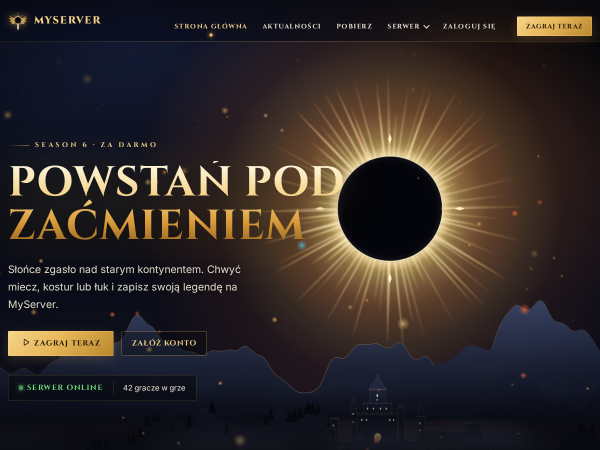

## Funkcje

- **Strona główna**: pełnoekranowa animowana scena (warstwy z paralaksą, iskry na canvasie, pulsująca korona),
  status serwera na żywo, prezentacja klas (Dark Knight, Dark Wizard, Fairy Elf), najnowsze aktualności, jak zacząć,
  harmonogram wydarzeń, top 5 rankingu, wezwanie do pobrania/Discorda, rozbudowana stopka.
- **Spokojne animowane tło** na pozostałych stronach. Przy `prefers-reduced-motion` scena jest statyczna; animacja
  zatrzymuje się w ukrytej karcie.
- **Nagłówek**: przyklejony, szklany, zmniejsza się po przewinięciu; menu budowane ze stron po adresach (Start,
  Aktualności, Pobierz, podmenu *Serwer*: Ranking, Mini gry, Zbrojownia, Wydarzenia, Komendy; Konto); działa dotykiem;
  pełnoekranowe menu na telefonie; przycisk *Graj teraz*.
- **Szablony**: strona główna, aktualności, archiwum, wpis, strona, szeroka strona, wyszukiwarka, 404 i osobny szablon
  dla każdej strony serwera (ranking, mini gry, zbrojownia, wydarzenia, komendy, pobieranie, konto).
- **Style wtyczki** [OpenMU WP Connect](https://github.com/nolt/openmu-wp-connect): status, ranking, ranking mini gier,
  wydarzenia, zbrojownia, formularze konta, podpowiedzi, komunikaty.
- Czcionki w paczce (Cinzel, Inter; SIL OFL) jako woff2: żadnych zewnętrznych zapytań. Mały, odroczony skrypt vanilla.
- Tłumaczenia: angielskie, polskie.

## Wymagania

- WordPress 6.6 lub nowszy (testowane z 7.1), PHP 8.1 lub nowszy (testowane z 8.4).
- Opcjonalnie: wtyczka [OpenMU WP Connect](https://github.com/nolt/openmu-wp-connect), dla danych z serwera gry na żywo.

## Instalacja

1. Pobierz `openmu-eclipse-<wersja>.zip` z [Releases](../../releases) i wgraj w **Wygląd > Motywy > Dodaj nowy motyw >
   Wyślij motyw na serwer** albo skopiuj to repozytorium do `wp-content/themes/openmu-eclipse`. Włącz **OpenMU Eclipse**.
2. Zainstaluj wtyczkę [OpenMU WP Connect](https://github.com/nolt/openmu-wp-connect) i połącz ją ze swoim serwerem.
3. Ustaw prawdziwe linki: przyciski na stronie **Pobierz** i linki do Discorda (do tego czasu prowadzą do `#`).

## Co robi włączenie motywu

Włączenie motywu tworzy potrzebne strony po adresach (Start, Aktualności, Pobierz, Ranking, Mini gry, Zbrojownia,
Wydarzenia, Komendy, Konto), ustawia Start jako stronę główną i Aktualności jako stronę wpisów, a po przełączeniu
na inny motyw przywraca poprzednie ustawienia czytania. Strony z innymi adresami zostają nietknięte.

## Postacie klas i dane przedmiotów w zbrojowni (opcjonalnie)

Motyw nie zawiera plików klienta gry. Wtyczka OpenMU WP Connect szuka ich w
`wp-content/uploads/openmu-wp-connect-client/` i używa każdej części, którą tam znajdzie; czego
brakuje, tam zostaje wygląd motywu:

| Folder | Daje | Bez niego |
|---|---|---|
| `classes/` | postać klasy w ramce zbrojowni | emblemat klasy |
| `data/` (`items.json`, `item-sets.json`, `skills.json`) | pełne dymki przedmiotów: statystyki bazowe, wymagania, opisy | dymek z tym, co wysyła API |
| `character-view/` | okna zbrojowni z tekstur klienta | okna w kolorach motywu |

Foldery kopiuje się na serwer raz (SFTP, ssh, `docker cp`); wysyłanie mediów w WordPressie ich nie
utworzy. Ten sam folder działa z każdym motywem.

## Strony

Wtyczka w trybie demo, desktop o szerokości 1440 px. Kliknij obrazek, by zobaczyć pełny rozmiar.

| | | |
| --- | --- | --- |
| [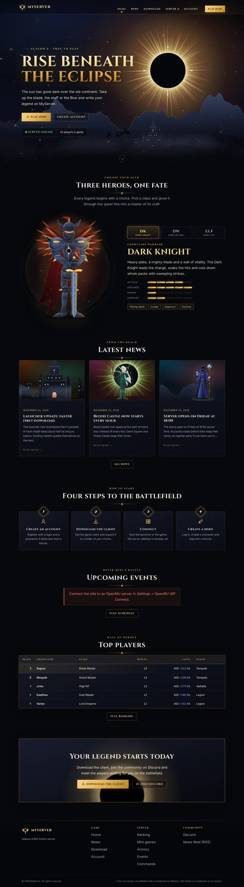](docs/assets/pages/home.webp) Strona główna | [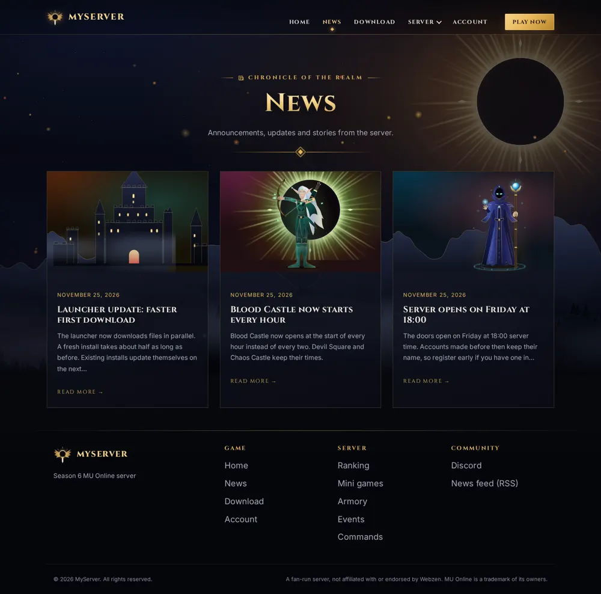](docs/assets/pages/news.webp) Aktualności | [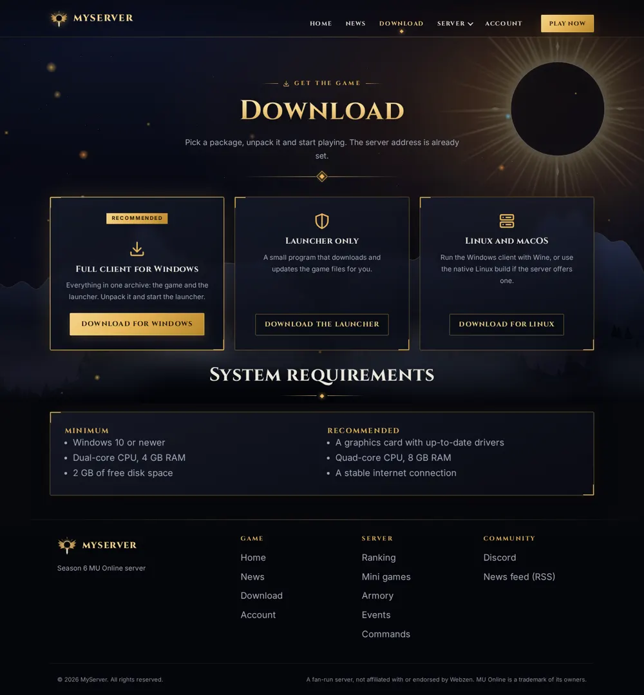](docs/assets/pages/download.webp) Pobierz |
| [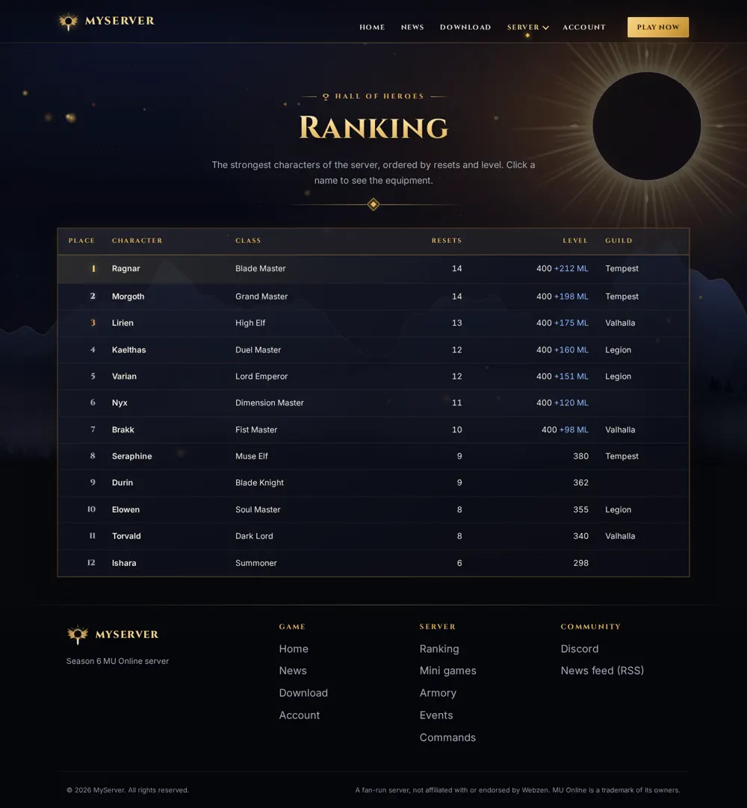](docs/assets/pages/ranking.webp) Ranking | [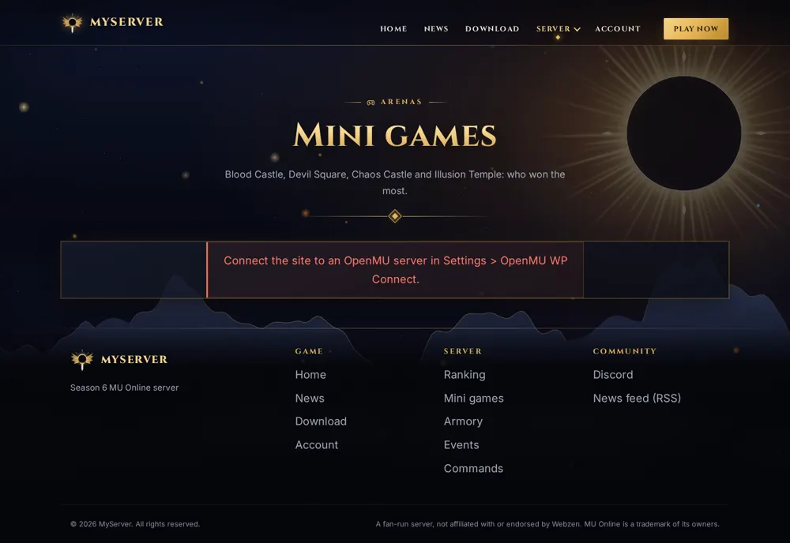](docs/assets/pages/mini-games.webp) Mini gry | [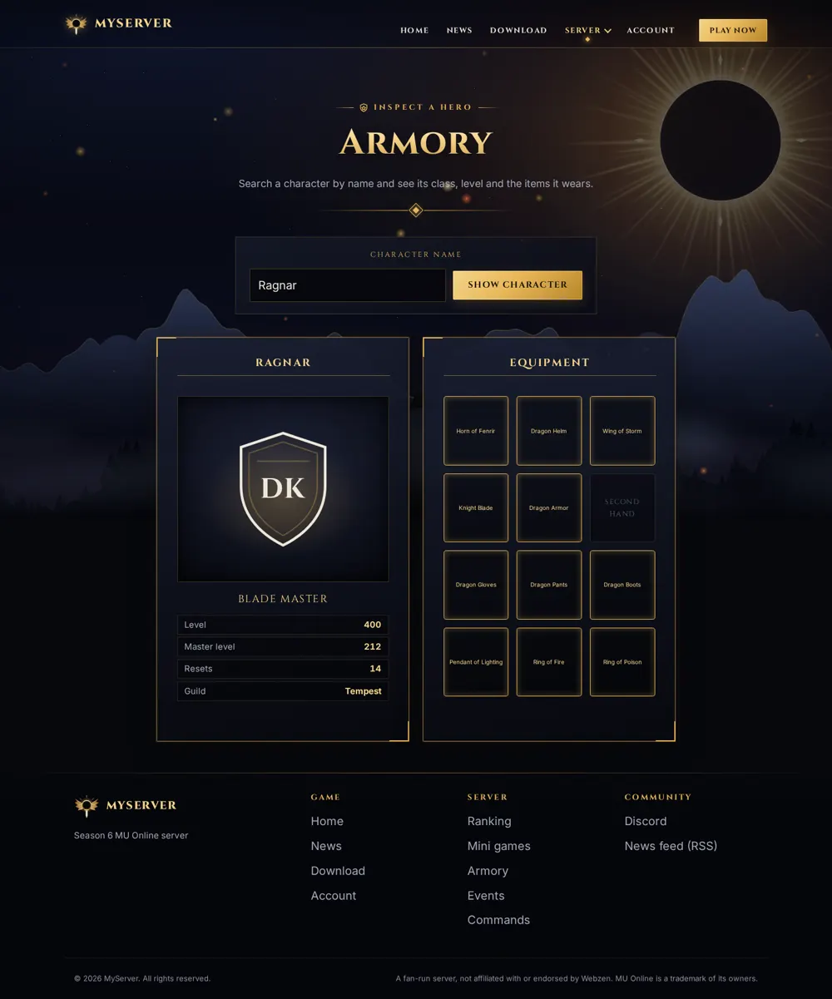](docs/assets/pages/armory.webp) Zbrojownia |
| [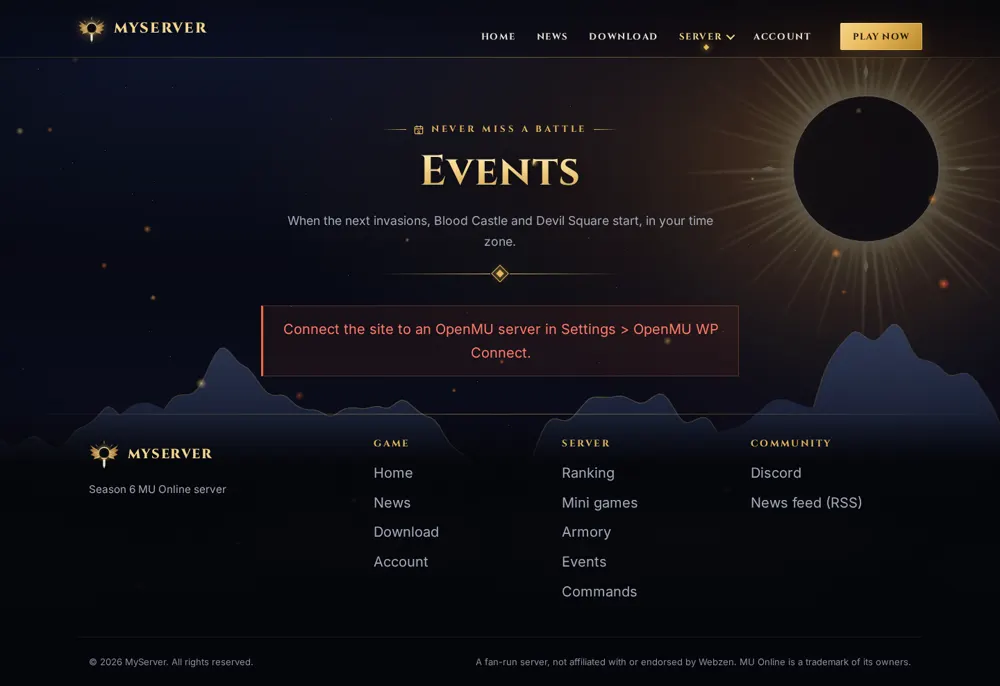](docs/assets/pages/events.webp) Wydarzenia | [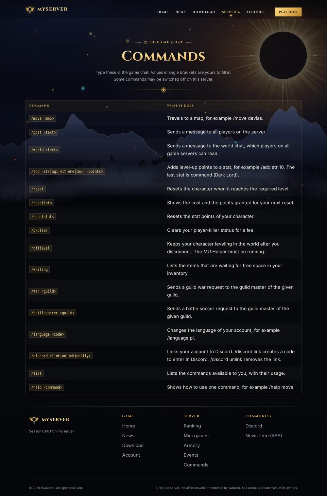](docs/assets/pages/commands.webp) Komendy | [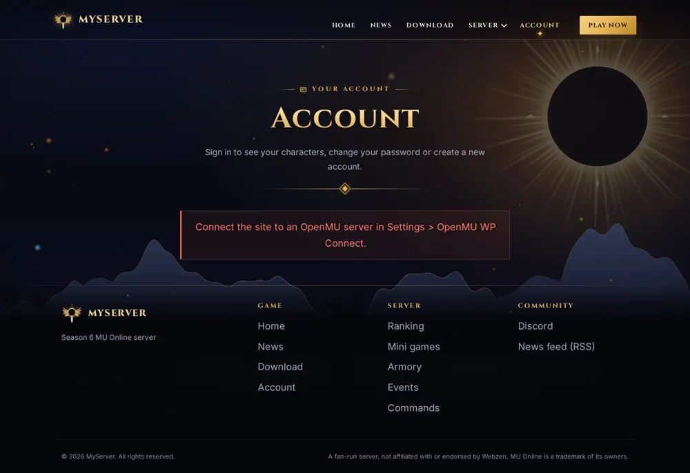](docs/assets/pages/account.webp) Konto |

| | | |
| --- | --- | --- |
| [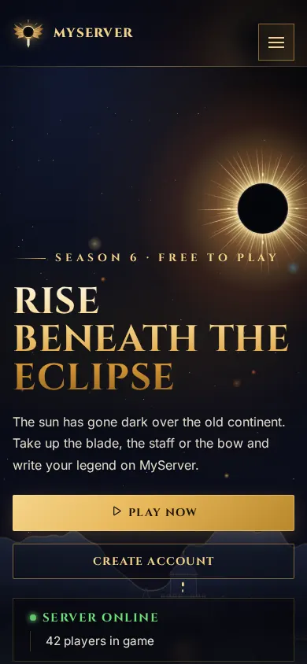](docs/assets/pages/phone-home.webp) Strona główna | [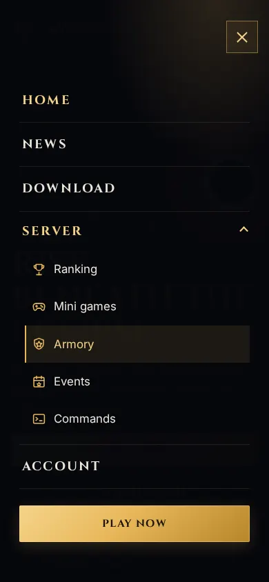](docs/assets/pages/phone-menu.webp) Menu | [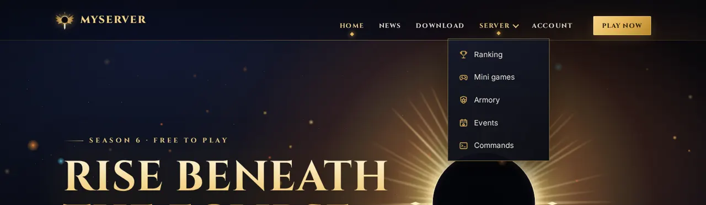](docs/assets/pages/menu-desktop.webp) Menu Serwer (desktop) |

## Grafiki i podziękowania

Wszystkie grafiki to oryginalne, ręcznie pisane SVG zrobione dla tego motywu (zob. [`assets/art/README.md`](assets/art/README.md)).
Czcionki: Cinzel i Inter, SIL Open Font License 1.1 (`assets/fonts/`).

MU Online jest znakiem towarowym firmy Webzen. Ten projekt to praca fanowska, niezwiązana z Webzen ani przez nią niepopierana.

## Licencja

GPL-2.0-or-later. Copyright (c) 2026 Nolt.
